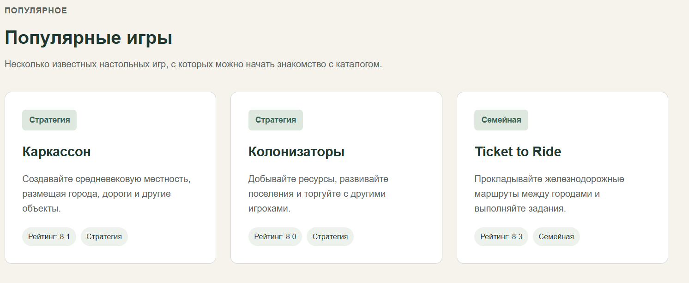
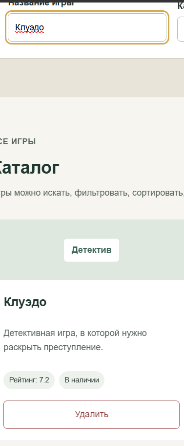
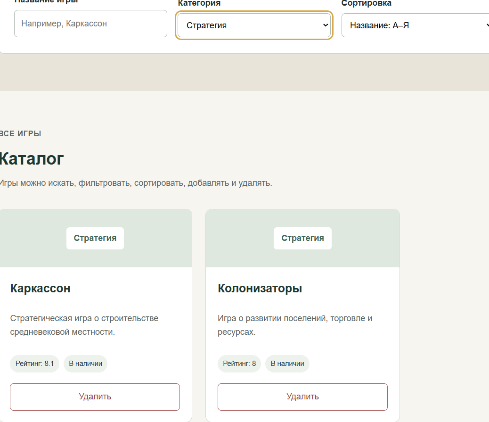
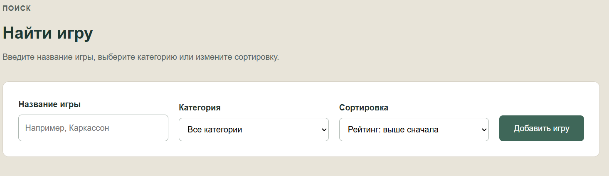
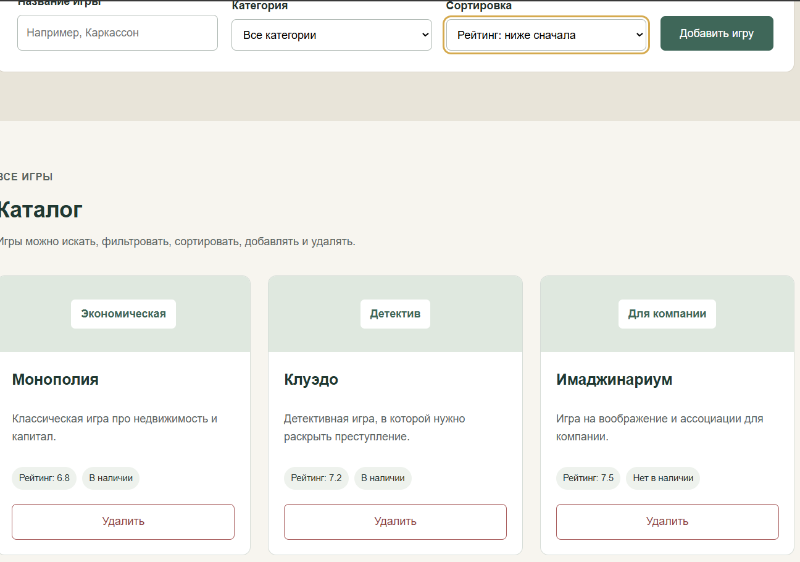
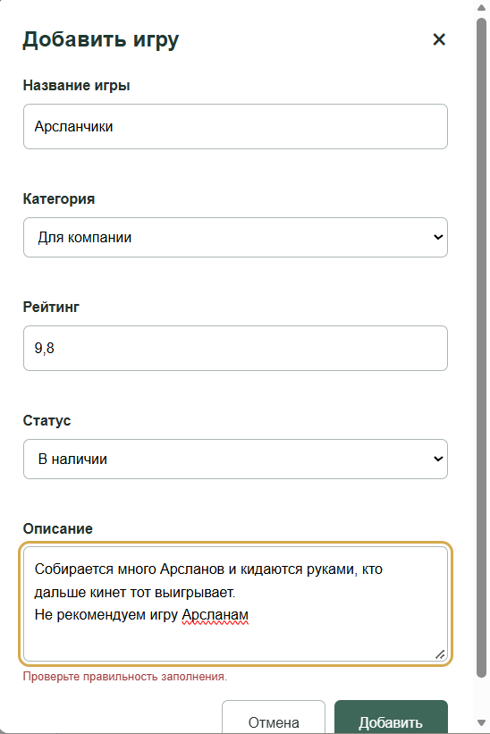
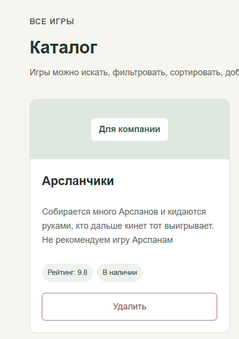

<div align="center">

Министерство науки и высшего образования Российской Федерации

Федеральное государственное бюджетное образовательное учреждение высшего образования

**«Уфимский университет науки и технологий»**

**Кафедра АСУ**

# Лабораторная работа №2


**Веб-приложение «Мир настольных игр»**

</div>

**Выполнил:** студент группы ИВТ-ИСУ-302Б

**ФИО:** Хубетдинов Арслан Илгамович

**Проверил:** Аитбаев Вадим Салимьянович

<div align="center">

Уфа — 2026

</div>

---

## 1. Цель работы

Модернизировать статический веб-проект, разработанный в лабораторной работе №1, и добавить интерактивную клиентскую логику с использованием JavaScript.

В ходе работы необходимо реализовать работу с DOM-деревом, обработку событий, поиск, фильтрацию, сортировку, клиентскую валидацию формы, добавление и удаление элементов, хранение данных в `localStorage`, а также организовать интерфейс на основе состояния приложения.

---

## 2. Постановка задачи

В качестве основы используется веб-приложение **«Мир настольных игр»**, созданное в лабораторной работе №1.

Во второй лабораторной работе необходимо добавить к существующему интерфейсу следующие возможности:

- динамический поиск игр;
- фильтрацию по категории;
- сортировку по названию и рейтингу;
- модальное окно для добавления новой игры;
- форму с клиентской валидацией;
- добавление новой карточки;
- удаление карточки;
- сохранение списка игр в `localStorage`;
- перерисовку интерфейса на основе объекта состояния `state`.

Вся логика реализована на чистом JavaScript без сторонних библиотек и фреймворков.

---

## 3. Структура проекта

Основные файлы проекта:

| Файл | Назначение |
| --- | --- |
| `index.html` | Структура страницы, элементы управления и форма добавления игры |
| `stilno/main.css` | Оформление страницы, адаптивность и стили модального окна |
| `js/app.js` | JavaScript-логика приложения |

Структура проекта:

```text
project/
├── index.html
├── stilno/
│   └── main.css
├── js/
│   └── app.js

```

JavaScript подключается перед закрывающим тегом `body`:

```html
<script src="js/app.js"></script>
```

---

## 4. Основные изменения по сравнению с лабораторной работой №1

В лабораторной работе №1 страница была статической. Карточки игр находились непосредственно в HTML, а форма поиска не выполняла реальный поиск.

Во второй лабораторной работе каталог стал интерактивным:

- карточки каталога создаются JavaScript-кодом;
- поиск работает сразу при вводе текста;
- категория изменяет отображаемый набор игр;
- сортировка меняет порядок карточек;
- новую игру можно добавить через модальное окно;
- карточку можно удалить;
- изменения сохраняются после перезагрузки страницы.

Раздел с популярными играми и общий внешний вид проекта сохранены.



*Рисунок 1 — Раздел «Популярные игры» в веб-приложении.*

---

## 5. Состояние приложения

Для хранения текущих данных используется единый объект `state`:

```javascript
const state = {
    items: savedItems ? JSON.parse(savedItems) : defaultItems,
    searchQuery: '',
    selectedCategory: 'all',
    sortBy: 'name-asc'
};
```

Свойства объекта:

| Свойство | Назначение |
| --- | --- |
| `items` | Массив настольных игр |
| `searchQuery` | Текущая строка поиска |
| `selectedCategory` | Выбранная категория |
| `sortBy` | Выбранный режим сортировки |

После изменения состояния вызывается функция:

```javascript
render();
```

Она заново формирует содержимое каталога на основе актуального состояния.

Таким образом, интерфейс строится по принципу:

```text
UI = render(State)
```

---

## 6. Динамический поиск

Для поиска используется текстовое поле:

```html
<input
    type="text"
    id="game-name"
    name="game-name"
    placeholder="Например, Каркассон"
>
```

Поиск работает в реальном времени по событию `input`:

```javascript
searchInput.addEventListener('input', (event) => {
    state.searchQuery = event.target.value;
    render();
});
```

При каждой введённой букве изменяется `searchQuery`, после чего каталог перерисовывается.

При поиске регистр символов не учитывается:

```javascript
const query = state.searchQuery.toLowerCase();
```

Проверяется как название игры, так и её описание.



*Рисунок 2 — Результат поиска игры «Клуэдо».*

---

## 7. Фильтрация по категории

Для фильтрации используется выпадающий список:

```html
<select id="genre" name="genre">
    <option value="all">Все категории</option>
    <option value="strategy">Стратегия</option>
    <option value="family">Семейная</option>
    <option value="party">Для компании</option>
    <option value="detective">Детектив</option>
    <option value="economic">Экономическая</option>
</select>
```

Пункт **«Все категории»** используется для сброса фильтра.

Обработка изменения категории:

```javascript
genreSelect.addEventListener('change', (event) => {
    state.selectedCategory = event.target.value;
    render();
});
```

При выборе категории в каталоге остаются только соответствующие игры.



*Рисунок 3 — Фильтрация каталога по категории «Стратегия».*

---

## 8. Сортировка

Для сортировки используется отдельный выпадающий список.

Реализованы четыре режима:

- название: А–Я;
- название: Я–А;
- рейтинг: выше сначала;
- рейтинг: ниже сначала.

Пример HTML:

```html
<select id="sort" name="sort">
    <option value="name-asc">Название: А–Я</option>
    <option value="name-desc">Название: Я–А</option>
    <option value="rating-desc">Рейтинг: выше сначала</option>
    <option value="rating-asc">Рейтинг: ниже сначала</option>
</select>
```

Перед сортировкой создаётся копия массива:

```javascript
const sorted = [...filtered];
```

Это позволяет не изменять исходный массив `state.items`.

Пример сортировки по рейтингу:

```javascript
if (state.sortBy === 'rating-desc') {
    return b.rating - a.rating;
}
```



*Рисунок 4 — Поиск, фильтрация, сортировка и кнопка добавления игры.*



*Рисунок 5 — Сортировка игр по рейтингу.*

---

## 9. Формирование карточек через DOM

Карточки каталога создаются не статически в HTML, а средствами JavaScript.

Для создания элементов используются методы:

```javascript
document.createElement()
```

и

```javascript
append()
```

Для пользовательских текстовых данных используется свойство:

```javascript
textContent
```

Например:

```javascript
const title = document.createElement('h3');
title.textContent = item.name;
```

Это позволяет безопасно выводить введённый пользователем текст и не использовать `innerHTML` для пользовательских данных.

---

## 10. Модальное окно

Новая игра добавляется через модальное окно.

Окно открывается кнопкой **«Добавить игру»**.

```javascript
openModalButton.addEventListener('click', openModal);
```

Закрытие реализовано четырьмя способами:

1. кнопкой `×`;
2. кнопкой «Отмена»;
3. клавишей `Escape`;
4. кликом по затемнённой подложке.

Пример закрытия по клавише `Escape`:

```javascript
document.addEventListener('keydown', (event) => {
    if (event.key === 'Escape') {
        closeModal();
    }
});
```

---

## 11. Форма добавления и клиентская валидация

В модальном окне находится форма добавления игры.

Поля формы:

- название;
- категория;
- рейтинг;
- статус;
- описание.

Для проверки данных используются HTML5-атрибуты:

```html
required
minlength="2"
min="1"
max="10"
```

Стандартная отправка формы перехватывается:

```javascript
event.preventDefault();
```

Проверка выполняется через объект `validity`:

```javascript
if (!field.validity.valid) {
    error.textContent = 'Проверьте правильность заполнения.';
}
```

Если поле заполнено неправильно, под ним отображается сообщение об ошибке.



*Рисунок 6 — Модальное окно и сообщение клиентской валидации.*

---

## 12. Добавление новой игры

После успешной проверки формы создаётся новый объект:

```javascript
const newGame = {
    id: String(Date.now()),
    name: formData.get('name').trim(),
    category: formData.get('category'),
    rating: Number(formData.get('rating')),
    description: formData.get('description').trim(),
    status: formData.get('status')
};
```

Затем объект добавляется в массив состояния:

```javascript
state.items = [...state.items, newGame];
```

После этого выполняются:

```javascript
saveItems();
render();
closeModal();
```

Новая карточка сразу появляется в каталоге.



*Рисунок 7 — Новая игра, добавленная пользователем в каталог.*

---

## 13. Удаление карточки и делегирование событий

На каждой карточке создаётся кнопка **«Удалить»**.

Для удаления используется делегирование событий: обработчик назначается один раз на общий контейнер каталога `gamesList`.

```javascript
gamesList.addEventListener('click', (event) => {
    const button = event.target.closest('.delete-button');

    if (button === null) {
        return;
    }

    const card = button.closest('.card');
    const id = card.dataset.id;

    state.items = state.items.filter(
        (item) => item.id !== id
    );

    saveItems();
    render();
});
```

Метод `closest()` определяет, была ли нажата кнопка удаления, и находит карточку, к которой относится эта кнопка.

После удаления массив `state.items` обновляется, данные сохраняются и интерфейс перерисовывается.

---

## 14. Хранение данных в localStorage

Для сохранения списка игр используется Web Storage API.

Функция сохранения:

```javascript
function saveItems() {
    localStorage.setItem(
        STORAGE_KEY,
        JSON.stringify(state.items)
    );
}
```

Массив объектов необходимо преобразовать в строку с помощью:

```javascript
JSON.stringify()
```

При загрузке страницы сохранённые данные восстанавливаются:

```javascript
const savedItems = localStorage.getItem(STORAGE_KEY);

const state = {
    items: savedItems
        ? JSON.parse(savedItems)
        : defaultItems,
    searchQuery: '',
    selectedCategory: 'all',
    sortBy: 'name-asc'
};
```

Для обратного преобразования используется:

```javascript
JSON.parse()
```

Если сохранённых данных ещё нет, приложение использует массив `defaultItems`.

Благодаря этому добавленные и удалённые игры сохраняются после перезагрузки страницы.

---

## 15. Обработка событий

В приложении используются события:

| Событие | Назначение |
| --- | --- |
| `input` | Поиск игры во время ввода |
| `change` | Изменение категории и сортировки |
| `click` | Открытие/закрытие окна и удаление карточки |
| `keydown` | Закрытие модального окна клавишей `Escape` |
| `submit` | Добавление новой игры |

События позволяют изменять состояние приложения без перезагрузки страницы.

---

## 16. Соответствие обязательным требованиям

| Требование | Реализация |
| --- | --- |
| Динамический поиск | Событие `input`, поиск по названию и описанию |
| Фильтрация | Выпадающий список категорий и пункт «Все категории» |
| Сортировка | А–Я, Я–А, рейтинг по возрастанию и убыванию |
| Модальное окно | Добавление игры через отдельное окно |
| Валидация | `required`, `minlength`, `min`, `max`, `validity` |
| Удаление | Делегирование событий и `closest()` |
| `localStorage` | `JSON.stringify()` и `JSON.parse()` |
| State-Driven UI | Объект `state` и функция `render()` |

В JavaScript используются `const` и `let`. Устаревший `var` не применяется. Для сравнений используется строгое сравнение `===`.

Сторонние библиотеки и SPA-фреймворки не используются.

---

## 17. Проверка работы приложения

Для проверки лабораторной работы необходимо выполнить следующие действия:

1. Ввести часть названия игры и убедиться, что каталог изменяется сразу.
2. Выбрать одну из категорий и проверить фильтрацию.
3. Выбрать различные режимы сортировки.
4. Открыть окно «Добавить игру».
5. Попытаться отправить форму с некорректными данными и проверить сообщение об ошибке.
6. Добавить новую игру.
7. Обновить страницу и убедиться, что добавленная игра сохранилась.
8. Удалить одну из карточек.
9. Обновить страницу и убедиться, что удалённая игра не появилась снова.
10. Закрыть модальное окно крестиком, кнопкой «Отмена», клавишей `Escape` и кликом по подложке.

---

## 18. Результат работы

В результате статический каталог настольных игр был преобразован в интерактивное клиентское веб-приложение.

Реализованы динамический поиск, фильтрация и сортировка игр. Добавлено модальное окно с формой создания новой карточки и клиентской валидацией. Реализовано удаление карточек через делегирование событий.

Данные каталога хранятся в `localStorage`, поэтому изменения сохраняются после перезагрузки страницы.

Интерфейс формируется на основе объекта состояния `state` с помощью функции `render()`.

---

## 19. Заключение

В ходе лабораторной работы была изучена работа JavaScript с DOM-деревом и пользовательскими событиями.

Была реализована динамическая перерисовка каталога, поиск, фильтрация, сортировка, добавление и удаление элементов. Для проверки формы использован Constraint Validation API, а для постоянного хранения данных — Web Storage API `localStorage`.

В результате проект из лабораторной работы №1 был дополнен интерактивной логикой и преобразован в одностраничное клиентское приложение.
