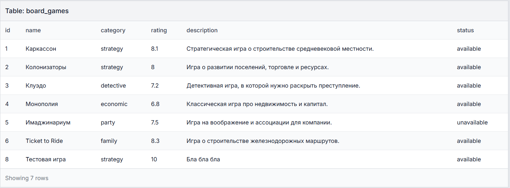
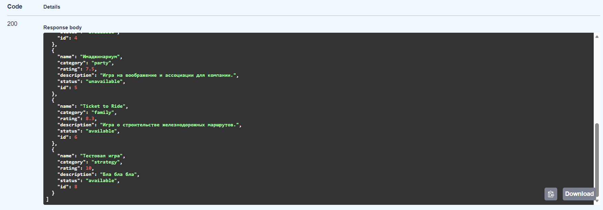
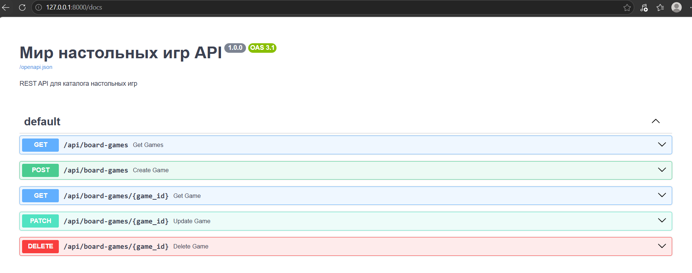
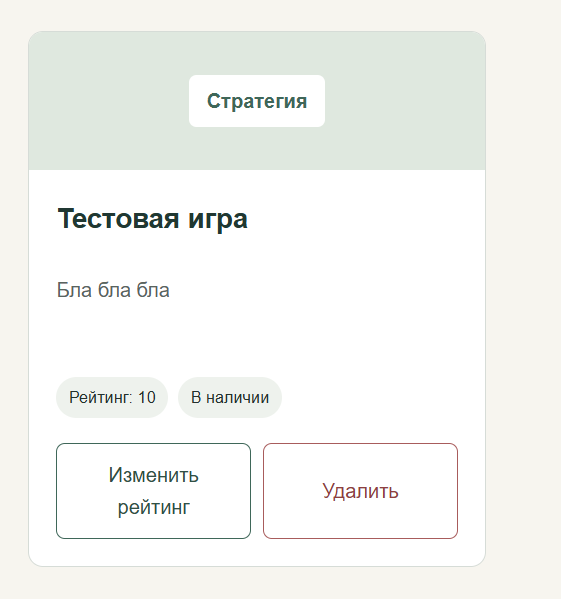
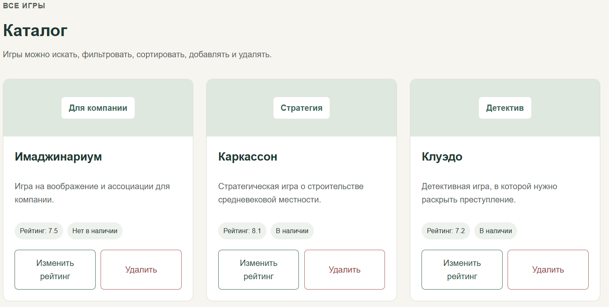

<div align="center">

Министерство науки и высшего образования Российской Федерации

Федеральное государственное бюджетное образовательное учреждение высшего образования

**«Уфимский университет науки и технологий»**

**Кафедра АСУ**

# Лабораторная работа №3

## «Backend с REST API и базой данных»

**Веб-приложение «Мир настольных игр»**

</div>

**Выполнил:** студент группы ИВТ-ИСУ-302Б

**ФИО:** Хубетдинов Арслан Илгамович

**Проверил:** Аитбаев Вадим Салиьянович

<div align="center">

Уфа — 2026

</div>

---

## 1. Цель работы

Разделить веб-приложение на клиентскую и серверную части, реализовать backend на Python, REST API для CRUD-операций, хранение данных в реляционной базе данных и получение данных на frontend через HTTP-запросы.

Для автоматической документации API используется Swagger UI и OpenAPI.

---

## 2. Постановка задачи

В качестве основы используется веб-приложение **«Мир настольных игр»**, разработанное в предыдущих лабораторных работах.

Основная сущность проекта — **настольная игра**.

Для неё необходимо реализовать:

- получение списка игр;
- создание новой игры;
- получение одной игры по идентификатору;
- изменение данных игры;
- удаление игры;
- хранение данных в базе данных SQLite;
- загрузку и изменение данных на frontend через REST API;
- автоматическую OpenAPI-документацию.

Поиск, фильтрация и сортировка из лабораторной работы №2 сохранены на frontend.

---

## 3. Структура проекта

Структура проекта после добавления backend:

```text
laba 1/
├── backend/
│   ├── board_games.db
│   ├── main.py
│   └── requirements.txt
├── js/
│   └── app.js
├── stilno/
│   └── main.css
├── фотки/
├── index.html
├── README.md
├── README2.md
└── README3.md
```

Назначение основных файлов:

| Файл | Назначение |
| --- | --- |
| `backend/main.py` | Backend, подключение к SQLite, схемы и REST API |
| `backend/board_games.db` | База данных SQLite |
| `backend/requirements.txt` | Зависимости backend |
| `index.html` | Структура frontend |
| `js/app.js` | Запросы к API и логика интерфейса |
| `stilno/main.css` | Стили веб-приложения |
| `README3.md` | Отчёт по лабораторной работе №3 |


---

## 4. Основная сущность

Основной сущностью является настольная игра.

Поля сущности:

| Поле | Тип | Назначение |
| --- | --- | --- |
| `id` | integer | Уникальный идентификатор |
| `name` | string | Название игры |
| `category` | string | Категория |
| `rating` | number | Рейтинг от 1 до 10 |
| `description` | string | Описание |
| `status` | string | Статус наличия |

Пример объекта:

```json
{
  "id": 8,
  "name": "Тестовая игра",
  "category": "strategy",
  "rating": 10,
  "description": "Бла бла бла",
  "status": "available"
}
```

---

## 5. Backend

Backend реализован на Python с использованием FastAPI.

Основное приложение создаётся следующим образом:

```python
app = FastAPI(
    title="Мир настольных игр API",
    version="1.0.0",
    description="REST API для каталога настольных игр"
)
```

Backend находится в одном файле `backend/main.py`, чтобы структура проекта оставалась простой и удобной для учебной работы.

---

## 6. База данных SQLite

Для хранения данных используется реляционная база данных SQLite.

Путь к базе:

```python
DB_PATH = Path(__file__).parent / "board_games.db"
```

Подключение выполняется функцией:

```python
def get_connection():
    connection = sqlite3.connect(DB_PATH)
    connection.row_factory = sqlite3.Row
    return connection
```

При запуске backend создаётся таблица `board_games`, если она ещё не существует:

```sql
CREATE TABLE IF NOT EXISTS board_games (
    id INTEGER PRIMARY KEY AUTOINCREMENT,
    name TEXT NOT NULL,
    category TEXT NOT NULL,
    rating REAL NOT NULL,
    description TEXT NOT NULL,
    status TEXT NOT NULL
)
```

Для рейтинга и допустимых значений категории и статуса используются ограничения `CHECK`.



*Рисунок 1 — Таблица `board_games` в базе данных SQLite. В таблице также присутствует добавленная пользователем «Тестовая игра».*

---

## 7. Валидация данных

Для проверки входных данных используются Pydantic-схемы.

Схема создания игры:

```python
class BoardGameCreate(BaseModel):
    name: str = Field(min_length=2, max_length=100)
    category: Category
    rating: float = Field(ge=1, le=10)
    description: str = Field(min_length=10, max_length=1000)
    status: GameStatus
```

Таким образом, backend проверяет:

- длину названия;
- допустимую категорию;
- рейтинг от 1 до 10;
- минимальную длину описания;
- допустимый статус.

Некорректные данные не записываются в базу.

---

## 8. REST API

Для сущности «Настольная игра» реализован полный CRUD.

| Метод | Путь | Назначение |
| --- | --- | --- |
| `GET` | `/api/board-games` | Получить все игры |
| `POST` | `/api/board-games` | Создать новую игру |
| `GET` | `/api/board-games/{game_id}` | Получить игру по `id` |
| `PATCH` | `/api/board-games/{game_id}` | Частично изменить игру |
| `DELETE` | `/api/board-games/{game_id}` | Удалить игру |

Используются основные HTTP-коды:

| Код | Назначение |
| --- | --- |
| `200 OK` | Успешное получение или изменение |
| `201 Created` | Игра успешно создана |
| `204 No Content` | Игра успешно удалена |
| `400 Bad Request` | Нет данных для изменения |
| `404 Not Found` | Игра не найдена |
| `422 Unprocessable Content` | Ошибка валидации |

---

## 9. Получение списка игр

Endpoint:

```python
@app.get("/api/board-games", response_model=list[BoardGame])
def get_games():
    with get_connection() as db:
        rows = db.execute(
            "SELECT * FROM board_games ORDER BY id"
        ).fetchall()

    return [dict(row) for row in rows]
```

Он выполняет SQL-запрос к таблице и возвращает список записей в формате JSON.



*Рисунок 2 — Ответ `GET /api/board-games`. В ответе присутствует добавленная «Тестовая игра».*

---

## 10. Создание игры

Для создания записи используется `POST /api/board-games`.

Backend выполняет SQL-запрос:

```python
cursor = db.execute("""
    INSERT INTO board_games
    (name, category, rating, description, status)
    VALUES (?, ?, ?, ?, ?)
""", (
    game.name,
    game.category,
    game.rating,
    game.description,
    game.status
))
```

После выполнения запроса вызывается:

```python
db.commit()
```

Это сохраняет изменения в базе данных.

---

## 11. Получение одной игры

Для получения одной записи используется:

```text
GET /api/board-games/{game_id}
```

Backend ищет запись по `id`:

```python
row = db.execute(
    "SELECT * FROM board_games WHERE id = ?",
    (game_id,)
).fetchone()
```

Если такой игры нет, сервер возвращает ошибку `404 Not Found`.

---

## 12. Изменение игры

Для частичного изменения используется:

```text
PATCH /api/board-games/{game_id}
```

На frontend в данной лабораторной работе изменяется рейтинг игры.

Пример запроса:

```json
{
  "rating": 9
}
```

После успешного изменения frontend повторно загружает список игр с сервера.

---

## 13. Удаление игры

Для удаления используется:

```text
DELETE /api/board-games/{game_id}
```

Backend выполняет:

```python
db.execute(
    "DELETE FROM board_games WHERE id = ?",
    (game_id,)
)

db.commit()
```

При успешном удалении возвращается статус:

```text
204 No Content
```

---

## 14. Swagger UI и OpenAPI

FastAPI автоматически создаёт документацию API.

Swagger UI доступен по адресу:

```text
http://127.0.0.1:8000/docs
```

OpenAPI-спецификация:

```text
http://127.0.0.1:8000/openapi.json
```

В Swagger отображаются все реализованные методы API.



*Рисунок 3 — Swagger UI с реализованными CRUD-методами REST API.*

---

## 15. Связь frontend и backend

В лабораторной работе №2 данные хранились на стороне браузера. В лабораторной работе №3 frontend получает данные с backend через `fetch()`.

Адрес API:

```javascript
const API_URL =
    'http://127.0.0.1:8000/api/board-games';
```

При открытии страницы вызывается функция:

```javascript
async function loadGames() {
    const response = await fetch(API_URL);
    state.items = await response.json();
    render();
}
```

Цепочка работы приложения:

```text
Frontend
   ↓ fetch()
FastAPI backend
   ↓
SQLite
   ↓
JSON-ответ
   ↓
state.items
   ↓
render()
   ↓
карточки на странице
```

---

## 16. Добавление записи с frontend

Форма добавления игры отправляет `POST`-запрос:

```javascript
const response = await fetch(API_URL, {
    method: 'POST',
    headers: {
        'Content-Type': 'application/json'
    },
    body: JSON.stringify(newGame)
});
```

После успешного ответа:

```javascript
await loadGames();
closeModal();
```

Frontend снова получает данные с backend и отображает новую карточку.



*Рисунок 4 — Игра «Тестовая игра», добавленная через frontend и сохранённая в базе данных.*

---

## 17. Отображение каталога

Карточки по-прежнему формируются функцией `render()`, но массив `state.items` теперь заполняется ответом REST API.

На карточке доступны:

- категория;
- название;
- описание;
- рейтинг;
- статус;
- кнопка изменения рейтинга;
- кнопка удаления.



*Рисунок 5 — Каталог настольных игр, данные которого загружены с backend.*

---

## 18. Запуск проекта

### 18.1. Backend

Перейти в папку backend:

```bash
cd backend
```

Создать виртуальное окружение:

```bash
python -m venv .venv
```

Активировать окружение в Windows:

```bash
.venv\Scripts\activate
```

Установить зависимости:

```bash
pip install -r requirements.txt
```

Запустить backend:

```bash
uvicorn main:app --reload
```

После запуска:

```text
http://127.0.0.1:8000/docs
```

---

### 18.2. Frontend

Во втором терминале перейти в папку проекта, где расположен `index.html`, и выполнить:

```bash
python -m http.server 5500
```

Открыть:

```text
http://127.0.0.1:5500
```

Backend при этом должен оставаться запущенным.

---

## 19. Проверка работы

В ходе проверки были выполнены следующие действия:

1. Запущен backend FastAPI.
2. Открыта Swagger-документация.
3. Проверено получение списка через `GET`.
4. Проверено получение записи по `id`.
5. Через frontend добавлена новая «Тестовая игра».
6. Проверено появление новой игры в ответе backend.
7. Проверено сохранение записи в таблице SQLite.
8. Проверено изменение рейтинга через `PATCH`.
9. Проверено удаление через `DELETE`.
10. Проверена загрузка карточек с backend на frontend.

---

## 20. Результат работы

В результате веб-приложение «Мир настольных игр» было преобразовано в клиент-серверное приложение.

Frontend получает данные через REST API. Backend реализован на Python с использованием FastAPI. Данные хранятся в базе SQLite.

Для основной сущности «Настольная игра» реализован полный набор CRUD-операций. Добавление, изменение и удаление данных выполняются через HTTP-запросы, после чего актуальные записи повторно загружаются на frontend.

---

## 21. Заключение

В ходе лабораторной работы были освоены основы клиент-серверного взаимодействия, проектирования REST API и работы с реляционной базой данных.

Был реализован backend на FastAPI, создана таблица SQLite, настроены CRUD-операции и автоматическая документация Swagger/OpenAPI.

Frontend предыдущей лабораторной работы был связан с backend с помощью `fetch()`. В результате данные каталога теперь хранятся не в браузере, а в базе данных и доступны через REST API.

---


