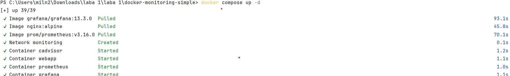
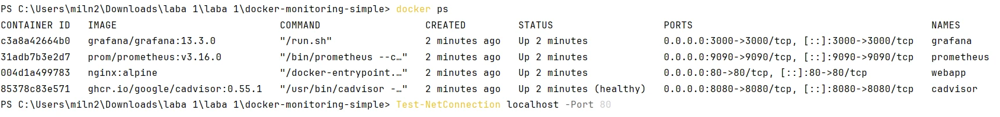
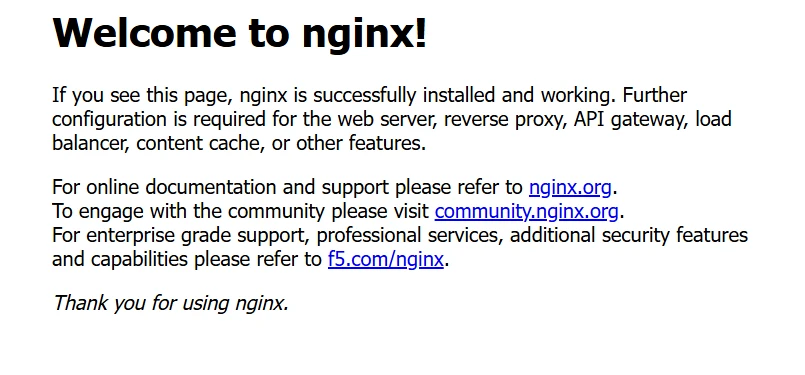
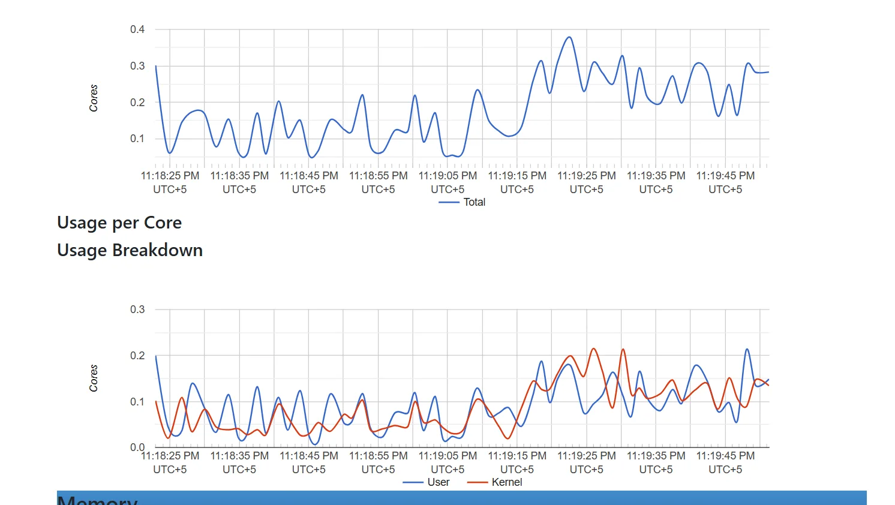
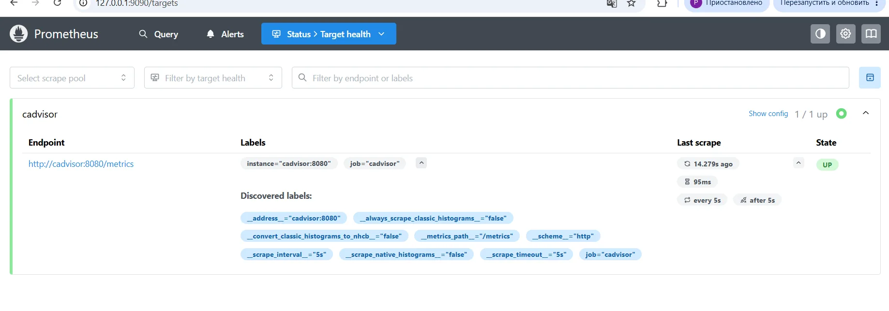
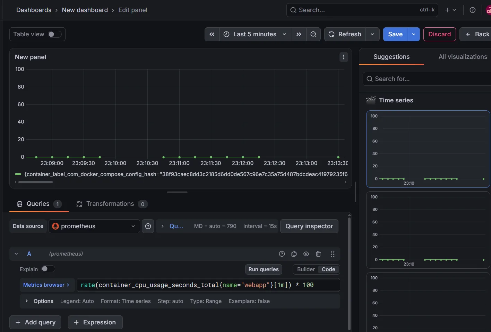
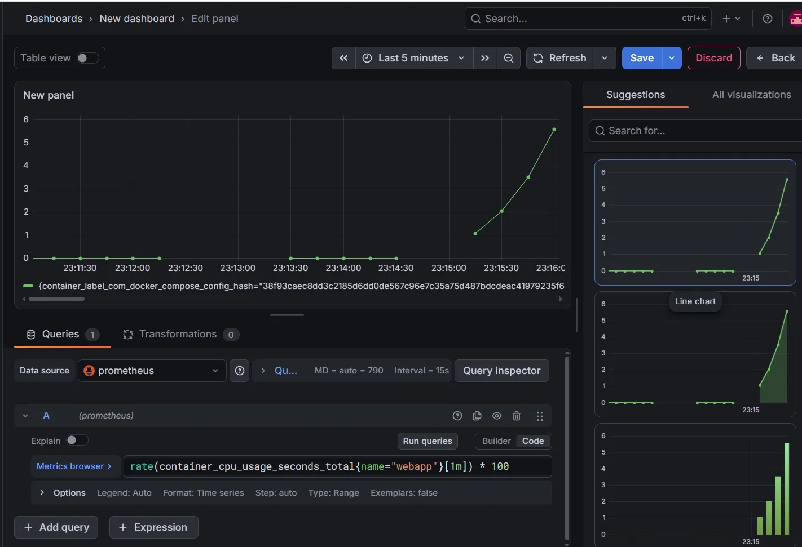

<div align="center">

Министерство науки и высшего образования Российской Федерации

Федеральное государственное бюджетное образовательное учреждение высшего образования

**«Уфимский университет науки и технологий»**

**Кафедра АСУ**

# Лабораторная работа №4

## «Мониторинг Docker-контейнеров с помощью Grafana и Prometheus»

</div>

**Выполнил:** студент группы ИВТ-ИСУ-302Б

**ФИО:** Хубетдинов Арслан Илгамович

**Проверил:** Аитбаев Вадим Салиьянович

<div align="center">

Уфа — 2026

</div>

---

## 1. Цель работы

Развернуть стек мониторинга Docker-контейнеров, включающий тестовое приложение, систему сбора метрик, систему хранения временных рядов и средство визуализации нагрузки.

В работе используются:

- **nginx** — тестовое веб-приложение;
- **cAdvisor** — сбор метрик контейнеров;
- **Prometheus** — хранение и обработка метрик;
- **Grafana** — визуализация данных;
- **Docker Compose** — совместный запуск сервисов.

---

## 2. Схема работы системы

Мониторинг построен по следующей схеме:

```text
[Docker-контейнеры]
        ↓
[cAdvisor]
собирает метрики CPU, памяти, сети и диска
        ↓
[Prometheus]
каждые 5 секунд получает и хранит метрики
        ↓
[Grafana]
выполняет запросы к Prometheus и строит графики
```

В качестве контейнера, на котором создаётся тестовая нагрузка, используется `nginx`.

---

## 3. Этап 1. Подготовка файлов конфигурации

Для выполнения работы создана отдельная директория:

```text
docker-monitoring-simple/
├── docker-compose.yml
└── prometheus.yml
```

### 3.1. Файл `docker-compose.yml`

В Docker Compose определены четыре сервиса:

```yaml
services:
  webapp:
    image: nginx:alpine
    container_name: webapp
    ports:
      - "80:80"
    networks:
      - monitoring

  cadvisor:
    image: ghcr.io/google/cadvisor:0.55.1
    container_name: cadvisor
    privileged: true
    ports:
      - "8080:8080"
    volumes:
      - /:/rootfs:ro
      - /var/run:/var/run:rw
      - /sys:/sys:ro
      - /var/lib/docker/:/var/lib/docker:ro
    networks:
      - monitoring

  prometheus:
    image: prom/prometheus:v3.16.0
    container_name: prometheus
    ports:
      - "9090:9090"
    volumes:
      - ./prometheus.yml:/etc/prometheus/prometheus.yml:ro
    depends_on:
      - cadvisor
    networks:
      - monitoring

  grafana:
    image: grafana/grafana:13.3.0
    container_name: grafana
    ports:
      - "3000:3000"
    depends_on:
      - prometheus
    networks:
      - monitoring

networks:
  monitoring:
    name: monitoring
```

Все контейнеры подключены к общей сети `monitoring`. Благодаря этому контейнеры могут обращаться друг к другу по именам сервисов, например `cadvisor:8080` и `prometheus:9090`.

### 3.2. Файл `prometheus.yml`

Конфигурация Prometheus:

```yaml
global:
  scrape_interval: 5s

scrape_configs:
  - job_name: "cadvisor"
    static_configs:
      - targets:
          - "cadvisor:8080"
```

Параметр `scrape_interval: 5s` задаёт интервал сбора метрик.

Источник метрик:

```text
cadvisor:8080
```

Prometheus обращается к cAdvisor по имени сервиса внутри Docker-сети.

---

## 4. Этап 2. Запуск стека мониторинга

Все контейнеры запускаются одной командой:

```powershell
docker compose up -d
```

Параметр `-d` запускает контейнеры в фоновом режиме.



*Рисунок 1 — Запуск сервисов через Docker Compose.*

После запуска проверяется состояние контейнеров:

```powershell
docker ps
```

Должны работать четыре контейнера:

- `webapp`;
- `cadvisor`;
- `prometheus`;
- `grafana`.



*Рисунок 2 — Запущенные Docker-контейнеры.*

Используемые порты:

| Сервис | Порт | Адрес |
| --- | ---: | --- |
| nginx | 80 | `http://127.0.0.1` |
| cAdvisor | 8080 | `http://127.0.0.1:8080` |
| Prometheus | 9090 | `http://127.0.0.1:9090` |
| Grafana | 3000 | `http://127.0.0.1:3000` |

---

## 5. Проверка тестового приложения nginx

В качестве тестового приложения используется nginx.

В `docker-compose.yml` он описан как сервис:

```yaml
webapp:
  image: nginx:alpine
  container_name: webapp
  ports:
    - "80:80"
```

После запуска nginx доступен по адресу:

```text
http://127.0.0.1
```



*Рисунок 3 — Работа тестового веб-приложения nginx.*

---

## 6. Этап 3. Проверка cAdvisor

cAdvisor используется для сбора метрик запущенных Docker-контейнеров.

Он собирает данные о:

- использовании CPU;
- использовании оперативной памяти;
- сетевом трафике;
- дисковых операциях;
- состоянии контейнеров.

Интерфейс cAdvisor доступен по адресу:

```text
http://127.0.0.1:8080
```



*Рисунок 4 — Метрики контейнеров в интерфейсе cAdvisor.*

На графиках cAdvisor видно изменение использования процессорных ресурсов контейнерами.

---

## 7. Этап 4. Проверка Prometheus

Prometheus доступен по адресу:

```text
http://127.0.0.1:9090
```

Для проверки подключения cAdvisor открыт раздел:

```text
Status → Target health
```

Target `cadvisor` имеет состояние:

```text
UP
```



*Рисунок 5 — cAdvisor успешно подключён к Prometheus, состояние target — UP.*

На скриншоте также видно:

```text
http://cadvisor:8080/metrics
```

Это endpoint, с которого Prometheus получает метрики.

Для дополнительной проверки в Prometheus можно выполнить запрос:

```promql
container_cpu_usage_seconds_total
```

Также состояние cAdvisor проверяется запросом:

```promql
up{job="cadvisor"}
```

Значение `1` означает, что источник метрик доступен.

---

## 8. Этап 5. Подключение Grafana к Prometheus

Grafana доступна по адресу:

```text
http://127.0.0.1:3000
```

В Grafana добавлен новый Data Source типа **Prometheus**.

Для подключения используется URL:

```text
http://prometheus:9090
```

Используется имя `prometheus`, а не `localhost`, потому что Grafana работает внутри собственного Docker-контейнера. Внутри контейнера `localhost` указывает на сам контейнер Grafana.

После сохранения настройки Grafana может выполнять запросы к Prometheus.

---

## 9. Этап 6. Создание дашборда

В Grafana создан новый Dashboard и добавлена панель типа `Time series`.

Для отображения нагрузки CPU контейнера `webapp` используется PromQL-запрос:

```promql
rate(container_cpu_usage_seconds_total{name="webapp"}[1m]) * 100
```

Временной диапазон установлен:

```text
Last 5 minutes
```

До создания дополнительной нагрузки значения находятся на низком уровне.



*Рисунок 6 — Использование CPU контейнера webapp в обычном режиме.*

---

## 10. Этап 7. Создание нагрузки на контейнер

Для создания постоянной HTTP-нагрузки на nginx в PowerShell используется команда:

```powershell
while ($true) { curl.exe -s http://127.0.0.1 > $null }
```

Команда постоянно отправляет HTTP-запросы к контейнеру `webapp`.

После запуска нагрузки значение CPU на графике Grafana начинает увеличиваться.



*Рисунок 7 — Рост использования CPU контейнера webapp во время нагрузки.*

Нагрузку можно остановить сочетанием:

```text
Ctrl + C
```

После прекращения запросов нагрузка постепенно возвращается к обычному уровню.

---

## 11. Этап 8. Анализ результатов

До запуска тестовой нагрузки контейнер `webapp` практически не выполнял дополнительной работы, поэтому значение использования CPU находилось около минимального уровня.

После запуска бесконечного цикла HTTP-запросов к nginx контейнер начал обрабатывать большое количество запросов. cAdvisor зафиксировал увеличение использования CPU, Prometheus получил новые значения метрик, а Grafana отобразила рост нагрузки на графике.

Таким образом, эксперимент подтвердил правильную работу всей цепочки:

```text
HTTP-запросы
     ↓
nginx (webapp)
     ↓
cAdvisor фиксирует изменение нагрузки
     ↓
Prometheus сохраняет метрики
     ↓
Grafana отображает изменение на графике
```

---

## 12. Основные команды

Запуск контейнеров:

```powershell
docker compose up -d
```

Проверка состояния:

```powershell
docker ps
```

Просмотр логов:

```powershell
docker logs webapp
docker logs cadvisor
docker logs prometheus
docker logs grafana
```

Создание нагрузки:

```powershell
while ($true) { curl.exe -s http://127.0.0.1 > $null }
```

Остановка нагрузки:

```text
Ctrl + C
```

Остановка и удаление контейнеров Compose-проекта:

```powershell
docker compose down
```

---

## 13. Результат работы

В результате работы был развёрнут стек мониторинга, состоящий из четырёх Docker-контейнеров.

Контейнер nginx используется как тестовое веб-приложение. cAdvisor собирает метрики контейнеров. Prometheus получает их каждые 5 секунд и хранит как временные ряды. Grafana подключена к Prometheus и отображает данные в виде графика.

При создании дополнительной HTTP-нагрузки на nginx был зафиксирован рост использования CPU, что подтверждает корректную работу мониторинга.

---

## 14. Заключение

В ходе лабораторной работы были изучены основные принципы мониторинга Docker-контейнеров.

С помощью Docker Compose были запущены nginx, cAdvisor, Prometheus и Grafana. Настроен сбор метрик контейнеров через cAdvisor, их получение и хранение в Prometheus, а также визуализация в Grafana.

Практическая проверка с созданием HTTP-нагрузки показала, что изменение нагрузки контейнера отображается в системе мониторинга практически в реальном времени.
